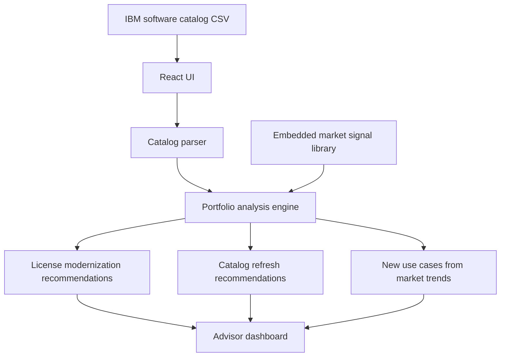

# watsonxchallengehorizon2

Horizon 2 Quebec squad repository for Watsonx challenge.

## IBM Catalog Modernization Advisor

This repository now contains a React + Vite application that analyzes an IBM software catalog exported as CSV and suggests:

- license modernization opportunities
- catalog refresh candidates based on stale metadata
- new use cases aligned to embedded market trend signals

## Expected catalog columns

Use a CSV with these headers:

`Product,Category,LicenseModel,Deployment,Capabilities,Version,LastUpdated`

You can paste CSV directly into the app or upload a `.csv` file.

## Architecture diagram

## Local development

1. Install Node.js and npm.
2. Run `npm install`
3. Run `npm run dev`
4. Run `npm run build`

