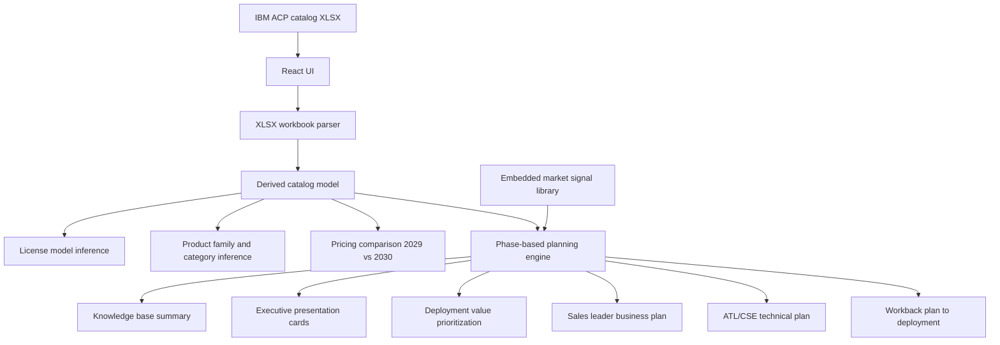

# watsonxchallengehorizon2

Horizon 2 Quebec squad repository for Watsonx challenge.

## IBM Catalog Modernization Advisor

This repository contains a React + Vite application that analyzes an IBM software catalog from the workbook [`../ibm-license-catalog.xlsx.xlsx`](../ibm-license-catalog.xlsx.xlsx) and uses the guidance in [`Build context file.docx`](Build context file.docx) to generate richer client-planning outputs.

## What the app now produces

Using the IBM ACP catalog workbook as the primary input, the app now supports a phased workflow aligned to the build context:

1. **Client-specific knowledge base**
   - summarizes the client's IBM software footprint
   - groups solutions into inferred categories
   - aligns the catalog to embedded market signals

2. **Executive client presentation framing**
   - generates `What / Why / How / Why Now` narratives for key solution families

3. **Deployment value analysis and prioritization**
   - ranks opportunities by consumption rate and pricing signals
   - highlights renewal and value-realization opportunities

4. **Account planning outputs**
   - business plan for technology sales leaders
   - technical plan for ATLs and CSEs

5. **Workback plan to deployment**
   - creates milestone-based planning from a user-selected target deployment date

## Input source

Primary workbook used during implementation:
- [`../ibm-license-catalog.xlsx.xlsx`](../ibm-license-catalog.xlsx.xlsx)
- primary sheet: `Table 1 ACP (Cad)`

The app expects an XLSX file with rows containing these fields:

- `S&S part number`
- `License part number`
- `Description`
- `Royalty`
- `Consumption rate (CAD)`
- `ACP S&S Unit Reference Price for NTE for 2029 (CAD)`
- `ACP S&S Unit Reference Price for NTE for 2030 (CAD)`

Because the workbook does not provide separate product family, category, or license model columns, the UI derives those values from the `Description` field.

## Architecture diagram



## Local development

1. Install Node.js and npm.
2. Run [`npm install`](package.json)
3. Run [`npm run dev`](package.json)
4. Run [`npm run build`](package.json)

## Docker

Build the image:

```powershell
docker build -t ibm-catalog-modernization-advisor .
```

Run the container:

```powershell
docker run --rm -p 8080:80 ibm-catalog-modernization-advisor
```

Then open `http://localhost:8080`.

The container build is defined in [`Dockerfile`](Dockerfile) and serves the production build with nginx.

## Dependencies

The app depends on [`xlsx`](package.json) to parse IBM catalog workbooks in the browser.
