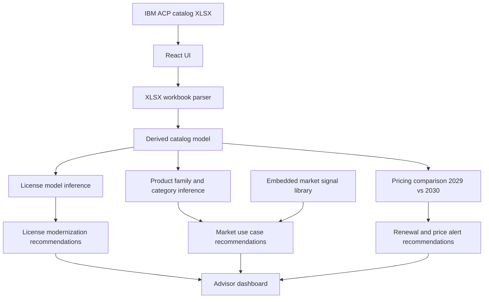

# watsonxchallengehorizon2

Horizon 2 Quebec squad repository for Watsonx challenge.

## IBM Catalog Modernization Advisor

This repository contains a React + Vite application that analyzes an IBM software catalog from the workbook [`../ibm-license-catalog.xlsx.xlsx`](../ibm-license-catalog.xlsx.xlsx) and suggests:

- license modernization opportunities
- new use cases aligned to embedded market trend signals
- proactive renewal opportunities based on 2029 to 2030 price increases

## Input source

The app now uses the IBM ACP catalog workbook as the source format.

Primary workbook used during implementation:
- [`../ibm-license-catalog.xlsx.xlsx`](../ibm-license-catalog.xlsx.xlsx)
- primary sheet: `Table 1 ACP (Cad)`

The app expects an XLSX file with rows containing these fields:

- `S&S part number`
- `License part number`
- `Description`
- `Royalty`
- `Consumption rate (CAD)`
- `ACP S&S Unit Reference Price for NTE for 2029 (CAD)`
- `ACP S&S Unit Reference Price for NTE for 2030 (CAD)`

Because the workbook does not provide separate product family, category, or license model columns, the UI derives those values from the [`Description`](../ibm-license-catalog.xlsx.xlsx) field.

## Architecture diagram

## Local development

1. Install Node.js and npm.
2. Run [`npm install`](package.json)
3. Run [`npm run dev`](package.json)
4. Run [`npm run build`](package.json)

## Dependencies

The app now depends on [`xlsx`](package.json) to parse IBM catalog workbooks in the browser.
